<h1 align="center">
  <a href="https://git.io/typing-svg">
    
  </a>
</h1>

<div align="center">
  
  <b>Welcome to my corner of GitHub!</b>
  
</div>

<br>

<div align="center">
  
  
  
</div>

<br>

<div align="center">
  <a href="https://swaraj-portfolio-alpha.vercel.app/"></a>
  <a href="https://linkedin.com/in/Swaraj_Prajapati"></a>
  <a href="https://leetcode.com/u/Swaraj_Prajapati/"></a>
  <a href="https://x.com/Swaraj_06"></a>
  <a href="https://swaraj-portfolio-alpha.vercel.app/Resume.pdf"></a>
</div>

<br>


## 👨‍💻 About Me


```js
const swaraj = {
  role: "Aspiring Full Stack Developer",
  education: "BE in Computer Engineering @ Swaminarayan University, Gujarat",
  stack: ["MongoDB", "Express.js", "React", "Next.js", "Node.js", "PostgreSQL", "MySQL"],
  strengths: ["DSA & Problem Solving", "Clean UI/UX", "Performance Optimization", "Teamwork"],
  currentlyGrinding: "LeetCode 🧩",
  funFact: "Gym + bodybuilding keeps my debugging stamina high 🏋️‍♂️",
  lookingFor: "Internships & entry-level full-stack roles 🚀",
};
```

- 🎓 Pursuing **BE in Computer Engineering** at Swaminarayan University, Gujarat
- 💻 Building scalable web apps with the **MERN Stack** and **Next.js**
- 🗄️ Comfortable with both **SQL** (PostgreSQL, MySQL) and **NoSQL** (MongoDB) databases
- 💡 Passionate about clean **UI/UX** and **performance optimization**
- 🧠 Strong in **DSA & problem solving**, grinding on [LeetCode](https://leetcode.com/u/Swaraj_Prajapati/)
- 🤝 Love collaborating and working in **team environments**
- 🏋️‍♂️ **Fun fact:** when I'm not coding, you'll find me in the gym chasing **fitness & bodybuilding** goals

<br clear="right"/>


## 💡 Always Coding

<div align="center">
  
  <br>
  
</div>


## 🎯 What I'm Up To

| 🔭 Working on | 🌱 Learning | 🎯 Goal |
|:---:|:---:|:---:|
| Full-stack MERN & Next.js projects | System design, PostgreSQL, advanced DSA | Land a full-stack developer role |

| 💬 Ask me about | ⚡ Fun fact |
|:---:|:---:|
| React, Next.js, Node.js, MongoDB, DSA | I plan my workouts like I plan my commits: consistent and progressive |


## 🛠️ Tech Stack

<div align="center">

**Frontend**


<br><br>

**Backend & Databases**


<br><br>

**Languages & Tools**


</div>


## 🧩 LeetCode Progress

<div align="center">
  <a href="https://leetcode.com/u/Swaraj_Prajapati/">
    
  </a>
  <br><br>
  <a href="https://leetcode.com/u/Swaraj_Prajapati/">
    
  </a>
</div>

> 💬 *"Consistency beats intensity: one problem a day keeps the rejection away."*


## 📊 GitHub Stats

<div align="center">
  <a href="https://github.com/SwarajPrajapati2006?tab=repositories">
    
  </a>
  <a href="https://github.com/SwarajPrajapati2006?tab=repositories">
    
  </a>
  <a href="https://github.com/SwarajPrajapati2006?tab=followers">
    
  </a>
</div>

<br>

<div align="center">
  
  
</div>

<br>

<div align="center">
  
</div>


## 🏆 GitHub Trophies

<div align="center">
  
</div>


## 📈 Contribution Activity

<div align="center">
  
</div>


## 🤝 Let's Connect

<div align="center">
  
</div>

<br>

<p align="center">
  Got an idea, an opportunity, or just want to talk code and gym? My inbox is open. 🚀
</p>

<div align="center">
  
</div>

<p align="center"><em>⭐ If you like my work, consider giving a star to my repositories!</em></p>


<!--
OPTIONAL: SNAKE ANIMATION (needs a separate workflow file, so it is not shown by default)
1. Create .github/workflows/snake.yml in this repo with:

name: Generate Snake Animation
on:
  schedule:
    - cron: "0 */12 * * *"
  workflow_dispatch:
permissions:
  contents: write
jobs:
  generate:
    runs-on: ubuntu-latest
    steps:
      - uses: Platane/snk/svg-only@v3
        with:
          github_user_name: ${{ github.repository_owner }}
          outputs: |
            dist/github-contribution-grid-snake.svg
            dist/github-contribution-grid-snake-dark.svg?palette=github-dark
      - uses: crazy-max/ghaction-github-pages@v3.1.0
        with:
          target_branch: output
          build_dir: dist
        env:
          GITHUB_TOKEN: ${{ secrets.GITHUB_TOKEN }}

2. Run it once from the Actions tab (Run workflow).
3. Then paste this above the footer image:


-->
